# TabTin Daemon 快速扫描概览

> 范围：`apps/tabtin-daemon`（TabTin Agent Daemon，无头执行运行时）
> 说明：本文档是快速扫描结果，描述 Daemon 的核心功能、对外暴露的接口，以及对应代码文件。深挖某个模块时建议从标注的文件继续向下追踪。

---

## 1. 总体定位

`@tabtin/daemon` 是 TabTin 的无头（headless）Agent 执行运行时，用于在远程服务器上常驻运行：

- 通过 WebSocket Gateway 连接 TabTin 后端，接收/执行 Agent Action，上报结果与事件；
- 对外（本机）暴露 CLI HTTP 服务、MCP 服务、本地 Table 服务；
- 提供 Lifetime/系统服务安装、诊断、日志、升级、存储治理、耗电/睡眠管理等运维能力。

入口链：

- `src/index.ts` → `src/entrypoints/daemon-cli.ts`（CLI 命令解析）
- `src/bootstrap/container.ts` → 依赖注入组合根（服务构造）
- `src/bootstrap/daemon.ts` → `TabTinDaemon` 启动/停止/生命周期编排

---

## 2. 对外暴露功能总览

| 面 | 暴露方式 | 对应代码 |
| --- | --- | --- |
| 命令行 CLI | `tabtin-daemon <command>` | `src/entrypoints/daemon-cli.ts` |
| 本机 CLI HTTP 服务 | Unix Socket / Named Pipe + HTTP **Daemon CLI Server**，供 `tabtin` CLI/本地工具发现调用（discovery 文件 `~/.tabtin/daemon-server.json`） | `src/transport/cli/cli-server.ts`、`src/transport/cli/routes/**` |
| 本机 MCP 服务 | `127.0.0.1` 动态端口 HTTP + JSON-RPC（MCP over HTTP），配置写 `~/.tabtin/mcp-server.json`，暴露 `tabtin_*` 工具 | `src/transport/mcp/mcp-server.ts`、`src/application/mcp/**` |
| 本机 Table 服务 | `127.0.0.1` 动态端口 HTTP（表/字段/记录/视图/查询），配置写 `~/.tabtin/daemon-table.json` | `src/transport/table/table-local-server.ts`、`src/platform/table/**` |
| 后端 Gateway WebSocket | 通过 `@tabtin/ws-gateway-client` 连接后端 WS，订阅/发布事件、执行 Action、心跳、能力上报、git 状态上报等 | `src/transport/gateway/gateway-client.ts`、`src/transport/gateway/heartbeat.ts` |
| Daemon Control API | 可选：向 `POST /daemon-control/v1/devices/register` 注册设备（带能力与运行时 profile） | `src/transport/gateway/daemon-control-registration.ts` |
| 系统服务 | systemd service / macOS launchd plist 模板 | `templates/tabtin-daemon.service`、`templates/com.tabtin.daemon.plist`、`src/platform/system/process/service-installer.ts`、`scripts/install.sh` |

---

## 3. 命令行命令（`src/entrypoints/daemon-cli.ts`）

| 命令 | 功能 | 主要源码/依赖 |
| --- | --- | --- |
| `init` | 用安装 token 初始化 Daemon，写入配置/指纹，并清理旧 owner 残留 | `handleInit`；`TokenAuth`（`src/transport/gateway/auth.ts`）、`ConfigManager`（`src/platform/system/config/config-manager.ts`） |
| `start` | 启动 Daemon，进入常驻运行 | `handleStart` → `TabTinDaemon.start()`（`src/bootstrap/daemon.ts`） |
| `stop` | 停止 Daemon，支持 `--drain` 优雅停任务 | `handleStop`/`drainDaemon` |
| `status` | 查看运行状态（`text` / `json`） | `handleStatus`；`StateWriter`（`src/platform/observability/diagnostics/state-writer.ts`） |
| `config` | 查看/设置配置；`--set key=value` 白名单受限 | `CONFIG_SETTABLE_KEYS` |
| `service` | 系统服务 `install` / `uninstall` | `ServiceInstaller`（`src/platform/system/process/service-installer.ts`） |
| `install-plugin` | 安装插件（npm 全局包 `@tabtin/daemon-plugin-*`） | `src/entrypoints/daemon-cli.ts`；`PluginManager`（`src/platform/plugins/plugin-manager.ts`） |
| `logs` | 查看/追踪日志，支持 `--follow --lines --level --since --format` | `viewLogs`（`src/platform/observability/diagnostics/log-viewer.ts`） |
| `doctor` | 健康诊断（配置/后端 API/WS/Token/Node/rg/进程/近期错误） | `runDoctor`（`src/platform/observability/diagnostics/doctor.ts`） |
| `update` | 检查/自动更新到最新版本 | `handleUpdate`；`Updater`（`src/platform/system/update/updater.ts`）、`daemon-version.ts` |
| `drain` | 通知运行的 Daemon 优雅停，等待在途任务结束 | `drainDaemon` （SIGUSR2 排空） |
| `storage` | 存储治理子命令：`list / size / list-items / clear / export / vacuum / drain / purge` | `src/application/storage/daemon-storage.ts` |
| `mttr-start` / `mttr-resolved` | 记录故障开始/恢复（MTTR 事件） | `src/entrypoints/daemon-cli.ts` |

---

## 4. Daemon CLI Server（本机 HTTP，socket/named pipe）

实现：`src/transport/cli/cli-server.ts`

### 4.1 通用端点

| 端点 | 说明 | 实现位置 |
| --- | --- | --- |
| `GET /health` | 健康检查 | `sendHealth`，`cli-server.ts` |
| `GET /dev/token` | 同一 OS 用户下刷新 token（受限） | `sendDevToken`，`cli-server.ts` |
| `GET /surfaces` | 暴露 Surface registry 清单 | `createSurfacesEndpoint`（`@tabtin/cli-server-core`） |
| PlatformSurface 路由 | 按 HTTP path 分发到注册的 surface handler | `getSurfaceByHttpPath` / `createSurfaceHttpHandler`（`@tabtin/cli-server-core`） |
| `/api/*` | 转发到 Django 后端（带 Daemon 凭据），透传 Agent 上下文头 | `proxyDjangoRequest` / `djangoRequest`，`cli-server.ts` 与 `routes/shared/error-handler.ts` |

### 4.2 业务路由前缀（route → 文件）

| 前缀 | 主要能力 | 文件 |
| --- | --- | --- |
| `/table/` | 表格数据/字段/视图/记录操作（本地 kernel + Django 转发） | `@tabtin/cli-routes`（`handleTableRoute`） |
| `/slide/` | Slide（PPT）创建/大纲/页面/导出/预览等 | `routes/media/slide.ts` |
| `/image/` `/media/` | 媒体生成/处理 | `routes/media/index.ts`（委托 `@tabtin/media-capabilities`） |
| `/video/` | 视频管线任务、WS 事件发布、优雅关闭 | `routes/media/video.ts` |
| `/audio/` `/speech/` | 语音/TTS 等 | `routes/media/speech.ts` |
| `/space/` | Space 操作 | `handleSpaceRoute`（`@tabtin/cli-routes`） |
| `/code/` | 代码/搜索（`grep` 有 20 次/分钟限流） | `handleCodeRoute` / `handleCodeRouteWithRateLimit`（`@tabtin/cli-routes`） |
| `/device/` | 设备信息代理：`/device/info`、`/device/battery`、`/device/network` | `routes/device/index.ts` |
| `/capabilities/` | 能力发现 | `handleCapabilitiesRoute`（`@tabtin/cli-routes`） |
| `/extensions/` | 扩展命令（含 marketplace 命令合并） | `handleExtensionsRoute`（`@tabtin/cli-routes`） |
| `/site/` | TabSite 建站：模板/构建产物/发布/回滚等 | `routes/media/tabsite.ts` |
| `/skills/` | Skill 列表/启用/禁用/import/npm 安装 | `routes/skills/index.ts`、`routes/skills/import-npm.ts` |
| `/storage/` | 存储命令（仅 POST） | `routes/storage/index.ts` → `src/application/storage/daemon-storage.ts` |
| `/browser/` | 浏览器自动化：open/act/glance/nav/tab/session/cookies/录制回放等 | `routes/browser/index.ts` |
| `/agent/` | Agent 本地会话：session 创建/查询、threads、models、fork、stream、cancel | `routes/agent/index.ts` |
| `/oss/` `/drive/` | OSS / drive 代理 | `@tabtin/cli-routes` |
| `/session/` `/desktop/` | 未实现 stub（Daemon 模式返回 501） | `stubRoute`，`cli-server.ts` |

---

## 5. MCP 服务（HTTP + JSON-RPC，`src/transport/mcp/mcp-server.ts`）

- 监听 `127.0.0.1:0` 动态端口，启动后写 `~/.tabtin/mcp-server.json`（`port`、`endpoint`、`bearer_token`、`tools`、`pid`）。
- 协议：JSON-RPC 2.0，支持：
  - `initialize`
  - `tools/list`
  - `tools/call`
  - `notifications/*`（空应答）
  - `GET /health`
- 安全：Bearer Token 鉴权；限制并发调用（`MAX_CONCURRENT_CALLS=5`）、body 10MB。
- 工具由 `src/application/mcp/mcp-tool-application.ts` + `registry.ts` + `domains/*` 实现，主要域：

| 域 | 工具前缀 | 对应文件 |
| --- | --- | --- |
| Table | `tabtin_table_*`、`tabtin_field_*`、`tabtin_view_*`、`tabtin_record_*` | `application/mcp/domains/table.ts` |
| Document | `tabtin_doc_*` | `application/mcp/domains/document.ts` |
| Memo | `tabtin_memo_*` | `application/mcp/domains/memo.ts` |
| SQL | `tabtin_sql_query` | `application/mcp/domains/sql.ts` |
| Site | `tabtin_site_*` | `application/mcp/domains/site.ts` |
| 适配器工具 | `adapter-tools.ts`（转发到 host action adapter，非本地名称） | `application/mcp/adapter-tools.ts` |

---

## 6. 本地 Table 服务（`src/transport/table/table-local-server.ts`）

- 监听 `127.0.0.1:0` 动态端口，写 `~/.tabtin/daemon-table.json`；Bearer Token 鉴权。
- 复用 `TableKernelService` / `@tabtin/table-kernel`，提供本地 PGlite 查询能力。
- 主要 HTTP 端点：

| 方法 | 路径 | 功能 |
| --- | --- | --- |
| GET | `/health` | 健康检查 |
| GET | `/table/sync-status?tableId=` | 同步状态 |
| POST | `/table/query`、`/table/filter-query` | 查询 |
| POST | `/table/records`、`PATCH/DELETE /table/records/:id`、`POST /table/records/batch` | 记录增删改/批处理 |
| POST | `/fields`、`PATCH/DELETE /fields/:id` | 字段 |
| POST | `/tables`、`PATCH/DELETE /tables/:id`、`/tables/:id/:action`（archive/restore） | 表 |
| POST | `/views`、`PATCH/DELETE /views/:id` | 视图 |

---

## 7. 后端 WebSocket Gateway（`src/transport/gateway/gateway-client.ts`）

- 通过 `WsGatewayClient` 连接 WS，角色 `daemon`，能力 `agent.action`，设备号 `fingerprint`。
- 订阅设备主题 `agent.action.device.<fingerprint>`；对活跃 thread 额外订阅 `agent.action.<threadId>`。
- 主要**收到**的事件类型：
  - `AgentActionEvents.REQUEST`（`agent.action.request`）
  - `agent.action.cancel`
  - `agent.prompt.forward / cancel / pause / resume`
  - `agent.subagent.cancel`
  - `agent.permission.response / reset_session / mode_update`
  - `LocalRuntimeEvents.USER_RESPONSE`（HITL 用户响应）
  - `agent.action.approval_memo_updated`
  - `git.diff.request`
  - `device.capabilities.refresh.request`
- 主要**发送**：
  - `sendActionResult`（执行结果）
  - `sendAgentEvent` / `relayEvents`（Stream 事件转发）
  - `sendGitDiffResponse` / `sendGitStatus`
  - `sendDeviceCapabilitiesReport` / `sendCapabilityRefreshAck` / `sendCapabilityRefreshResult`
- 心跳/能力/Token 续期在 `heartbeat.ts`，负责周期上报运行时快照、能力、git 状态、桥接更新检查与 Token 续期。

---

## 8. 启动生命周期与核心运行时（`src/bootstrap/daemon.ts`）

`TabTinDaemon.start()` 编排：

1. 初始化容器/基础设施（`container.ts`）；
2. 检测能力（`CapabilityDetector`）；启动 Pty 管理器、浏览器（如检测到）、本地 Agent Host；
3. 启动 gateway WS、心跳、SleepBlocker、StateWriter、Updater；
4. 启动 Table Local Server；
5. 启动 MCP Server；
6. 启动 CLI Server；
7. 注册 13 个 Daemon Storage bucket；
8. 可选：Daemon Control 设备注册；
9. 记录 in-flight 任务；`stop()` 时按 lifecycle 逆序释放，支持优雅 drain（SIGUSR2 → 等待任务 → SIGTERM）。

相关文件：
- `src/application/lifecycle/daemon-lifecycle.ts`：启动/停止编排
- `src/application/lifecycle/session-manager.ts`：WS runLoop/runSession 状态机（Disconnected→Connecting→Initializing→Running→Backoff）
- `src/platform/system/process/process-manager.ts`：PID/信号/清理
- `src/platform/system/process/sleep-blocker.ts`：防止系统休眠
- `src/platform/system/update/updater.ts`：周期更新检查

---

## 9. 数据/状态/工作区能力

| 能力 | 文件 |
| --- | --- |
| Agent 本地执行 host | `src/application/agent/daemon-agent-host.ts`、`daemon-agent-transport.ts`、`daemon-tool-provider.ts` |
| Action 执行桥（含 Approval、Monitor、Cap 工具、远程 FS） | `src/application/execution/action-bridge.ts`、`monitor-executor.ts`、`remote-fs-handlers.ts`、`action-admission-controller.ts` |
| MCP 权限/安全 | `src/application/mcp/security.ts` |
| 工作区路径访问控制 | `src/application/security/path-access.ts` |
| 文件历史/Checkpoint | `src/platform/workspace/file-history/file-history-registry.ts`、`src/platform/workspace/checkpoint/CheckpointService.ts` |
| 终端/PTY | `src/platform/terminal/terminal-runtime.ts`、`daemon-pty-manager.ts`、`DaemonPtyManagerBridge.ts` |
| 浏览器 | `src/platform/browser/*`、`src/application/agent/daemon-tool-provider.ts`（集成 browser tools） |
| Storage | `src/application/storage/daemon-storage.ts`、`src/platform/storage/storage-bucket-registration.ts`、`offline-buffer.ts` |
| 诊断 | `src/platform/observability/diagnostics/*`（`state-writer.ts`、`doctor.ts`、`log-viewer.ts`） |
| 遥测/Sentry | `src/platform/observability/telemetry/telemetry-sink.ts`、`logging/sentry.ts` |
| Git 状态 | `src/platform/observability/git-status/*` |

---

## 10. 快速定位建议

- 看 Daemon 有哪些对外命令：先看 `src/entrypoints/daemon-cli.ts`。
- 看本地 HTTP 能力：先看 `src/transport/cli/cli-server.ts` 的 routeHandlers 和时间路由分发。
- 看给外部 LLM/工具用的能力：看 `src/transport/mcp/mcp-server.ts` 与 `src/application/mcp/`。
- 看远程/后端交互协议：看 `src/transport/gateway/*`。
- 看启动生命周期：看 `src/bootstrap/daemon.ts` 与 `src/bootstrap/container.ts`。
- 看运维（安装/日志/诊断/更新）：看 `src/platform/system/*`、`src/platform/observability/diagnostics/*`。

---

## 附录：可视化结构图

```mermaid
flowchart TB
  subgraph Ext["外部/客户端"]
    Backend["TabTin 后端 (Django + WS Gateway)"]
    LocalCLI["tabtin CLI / Electron / 本地工具"]
    McpClients["MCP 客户端"]
    TableClients["Table 客户端 / 本地工具"]
  end

  subgraph Daemon["apps/tabtin-daemon"]
    Entry["src/entrypoints/daemon-cli.ts<br/>CLI 命令入口"]
    Bootstrap["src/bootstrap/daemon.ts<br/>TabTinDaemon 生命周期"]
    Container["src/bootstrap/container.ts<br/>依赖注入组合根"]

    subgraph Transport["transport（对外通道）"]
      CliServer["CLI HTTP Server<br/>src/transport/cli/*"]
      McpServer["MCP HTTP+JSON-RPC<br/>src/transport/mcp/mcp-server.ts"]
      TableServer["本地 Table HTTP<br/>src/transport/table/table-local-server.ts"]
      Gateway["WS Gateway Client<br/>src/transport/gateway/gateway-client.ts"]
      Heartbeat["Heartbeat / 能力上报<br/>src/transport/gateway/heartbeat.ts"]
      Control["Daemon Control 注册<br/>src/transport/gateway/daemon-control-registration.ts"]
    end

    subgraph App["application（业务逻辑）"]
      AgentHost["Agent Host / Runtime<br/>src/application/agent/*"]
      ActionBridge["Action Bridge / Executors<br/>src/application/execution/*"]
      McpApp["MCP Tool Application<br/>src/application/mcp/*"]
      StorageApp["Storage 应用<br/>src/application/storage/daemon-storage.ts"]
      Lifecycle["Lifecycle / SessionManager<br/>src/application/lifecycle/*"]
      Security["路径/权限/MCP 安全<br/>src/application/security/*"]
    end

    subgraph Platform["platform（平台能力）"]
      Pty["PTY / 终端<br/>src/platform/terminal/*"]
      Browser["浏览器自动化<br/>src/platform/browser/*"]
      System["进程/服务/睡眠/更新<br/>src/platform/system/*"]
      Workspace["Checkpoint / 文件历史<br/>src/platform/workspace/*"]
      StoragePlat["Storage Bucket / 离线缓冲<br/>src/platform/storage/*"]
      Diag["诊断/状态/日志/遥测<br/>src/platform/observability/*"]
      TableKernel["TableKernel / PGlite<br/>src/platform/table/*"]
    end
  end

  Backend -->|"WebSocket 事件/指令"| Gateway
  Gateway -->|"Action 结果/Stream/心跳"| Backend
  Backend -.->|"可选 HTTP"| Control
  LocalCLI -->|"HTTP over Unix Socket / Named Pipe"| CliServer
  McpClients -->|"HTTP + Bearer"| McpServer
  TableClients -->|"HTTP + Bearer"| TableServer

  Entry --> Bootstrap
  Bootstrap --> Container
  Bootstrap --> Transport
  Bootstrap --> App
  Bootstrap --> Platform
  Container --> Gateway
  Container --> Heartbeat
  Container --> ActionBridge
  CliServer --> McpApp
  CliServer --> StorageApp
  CliServer --> AgentHost
  McpServer --> McpApp
  McpServer --> ActionBridge
  TableServer --> TableKernel
  Gateway --> ActionBridge
  Heartbeat --> Gateway
  ActionBridge --> Pty
  ActionBridge --> Browser
  ActionBridge --> Workspace
  StorageApp --> StoragePlat
  Lifecycle --> System
  Diag --> Gateway
```

> 说明：该图展示 Daemon 的对外接入面（后端 WS、本地 CLI/MCP/Table HTTP）和内部核心模块分层。箭头表示主要调用/数据流，具体路由与端点清单见上文第 3–7 节。
